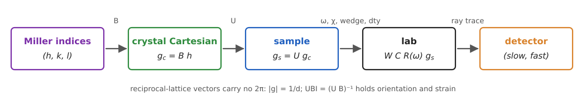
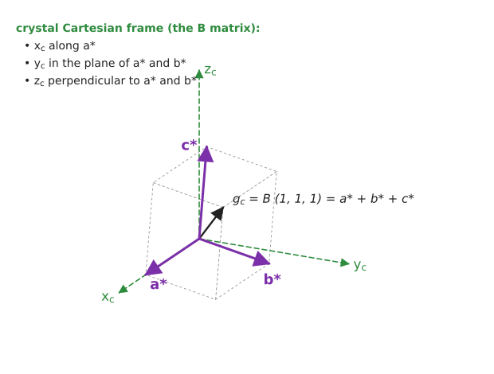
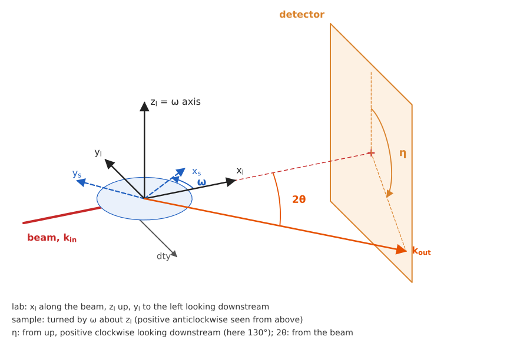
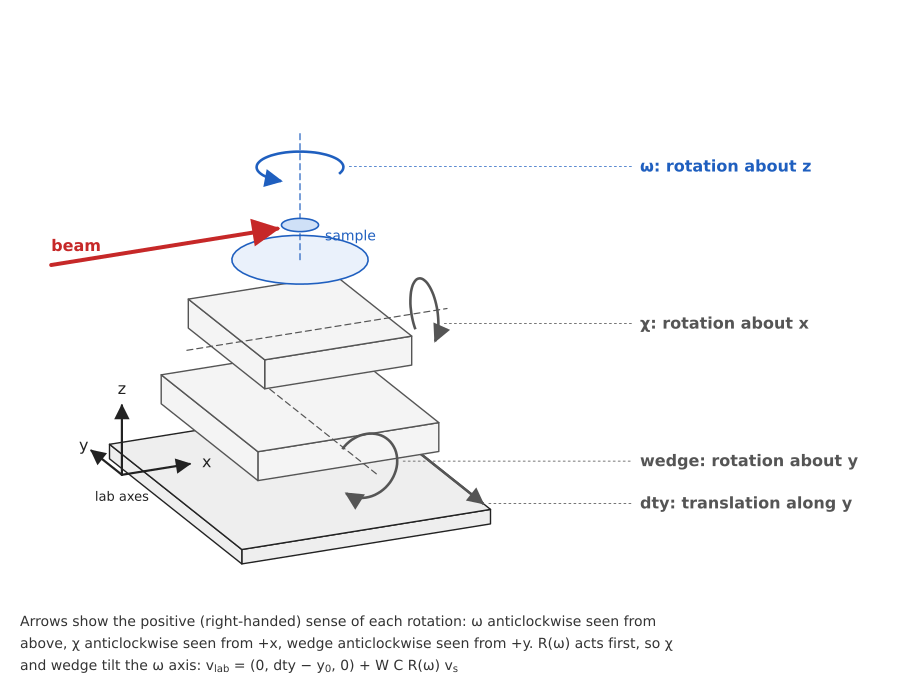
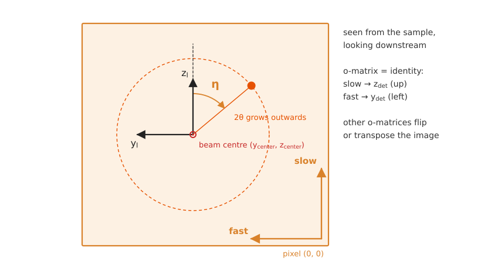

.. _theory_frames:

Reference frames
================

A reflection is described in five frames on its way from the crystal to a pixel. This page defines each and the
transform from one to the next, in the order a forward model applies them:

          ray trace.

    The chain of frames. Each arrow is one transform below.

Anri follows the FABLE geometry [FABLEgeom]_ (H.F. Poulsen, S. Schmidt, J. Wright, H.O. Sørensen, J. Oddershede and
A. Alpers, version 1.0.8, 2009), as ImageD11 [ImageD11]_ implements it. Where Anri differs, this page says so. The
FABLE document, which also covers Euler angles, strain and symmetry, is included as
:download:`Fable_Geometry_version_1.0.8.pdf <../tutorials/Fable_Geometry_version_1.0.8.pdf>`. All rotations are
right-handed and active: :math:`\matr{R}\vec{v}` turns the vector :math:`\vec{v}`. The tutorials
:doc:`../tutorials/crystallography`, :doc:`../tutorials/goniometer_geometry` and :doc:`../tutorials/detector_geometry`
compute each transform below with Anri's functions and check it.

**Code:** :func:`anri.maths.rotation.rot_x`, :func:`anri.maths.rotation.rot_y`, :func:`anri.maths.rotation.rot_z`.

Miller indices
--------------

A reflection is labelled by integer Miller indices :math:`\vec{h} = (h, k, l)`. Its reciprocal-lattice vector is

.. math::
    :label: frm-hkl

    \vec{g} = h\,\vec{a}^* + k\,\vec{b}^* + l\,\vec{c}^*,
    \qquad \vec{a}_i \cdot \vec{a}^*_j = \delta_{ij},
    \qquad |\vec{g}| = d^* = \frac{1}{d_{hkl}},

with :math:`\vec{a}_i = (\vec{a}, \vec{b}, \vec{c})` the real-space and :math:`\vec{a}^*_j` the reciprocal basis
vectors. There is no factor of :math:`2\pi` (:doc:`conventions`). The lattice parameters
:math:`(a, b, c, \alpha, \beta, \gamma)` and :math:`(a^*, b^*, c^*, \alpha^*, \beta^*, \gamma^*)` follow from each other
through the metric tensors :math:`\matr{G} = [\vec{a}_i \cdot \vec{a}_j]` and :math:`\matr{G}^* = \matr{G}^{-1}`.

**Code:** :func:`anri.crystal.lattice.lpars_to_mt`, :func:`anri.crystal.lattice.mt_to_rmt`,
:func:`anri.crystal.lattice.mt_to_lpars`.

Crystal Cartesian frame
-----------------------

The crystal Cartesian frame :math:`(\hat{x}_c, \hat{y}_c, \hat{z}_c)` is fixed to the reciprocal lattice:
:math:`\hat{x}_c` along :math:`\vec{a}^*`, :math:`\hat{y}_c` in the plane of :math:`\vec{a}^*` and :math:`\vec{b}^*`,
and :math:`\hat{z}_c` perpendicular to that plane. In it, a reflection is :math:`\vec{g}_c = \matr{B}\vec{h}`, with the
:math:`\matr{B}` matrix [BusingLevy1967]_ (equation 3; FABLE equation 2.7):

.. math::
    :label: frm-B

    \matr{B} =
    \begin{bmatrix}
    a^* & b^* \cos\gamma^* & c^* \cos\beta^* \\
    0 & b^* \sin\gamma^* & -c^* \sin\beta^* \cos\alpha \\
    0 & 0 & 1/c
    \end{bmatrix},
    \qquad
    \vec{g}_c = \matr{B}\, \vec{h}.

The columns of :math:`\matr{B}` are :math:`\vec{a}^*`, :math:`\vec{b}^*`, :math:`\vec{c}^*` in the crystal frame, and
:math:`\matr{B}^T\matr{B} = \matr{G}^*`. (FABLE writes the last element as :math:`c^* \sin\beta^* \sin\alpha`, which
equals :math:`1/c`.)

**Code:** :func:`anri.crystal.lattice.lpars_rlpars_to_B`, :func:`anri.crystal.lattice.lpars_to_B`,
:func:`anri.crystal.structure.B_matrix`.

          plane of a-star and b-star, z perpendicular to both.

    The crystal Cartesian frame of a triclinic reciprocal cell, and :math:`\vec{g}_c` for :math:`\vec{h} = (1, 1, 1)`.

Sample frame
------------

The orientation :math:`\matr{U}`, a proper rotation, takes the crystal Cartesian frame to the sample frame
:math:`(\hat{x}_s, \hat{y}_s, \hat{z}_s)`, so a reflection's vector in the sample frame is

.. math::
    :label: frm-g

    \vec{g}_s = \matr{U}\matr{B}\, \vec{h} = \text{UBI}^{-1}\, \vec{h}.

A strained crystal has its own :math:`\matr{U}\matr{B}`, no longer :math:`\matr{U}` times the reference
:math:`\matr{B}`, so Anri carries the UBI, :math:`(\matr{U}\matr{B})^{-1}`, which holds orientation and strain together.
The rows of the UBI are the real-space lattice vectors :math:`\vec{a}`, :math:`\vec{b}`, :math:`\vec{c}` in the sample
frame, since :math:`h_i = \vec{a}_i \cdot \vec{g}`.

**Code:** :func:`anri.crystal.lattice.U_B_to_UBI`, :func:`anri.crystal.lattice.UBI_to_mt`,
:func:`anri.maths.utils.inv3`.

Two conventions to know when comparing with other software:

- **U or its inverse.** The texture community often writes an orientation as :math:`\matr{g} = \matr{U}^{-1}`, the
  passive rotation from the sample frame to the crystal frame (FABLE section 3). Anri, like ImageD11, stores
  :math:`\matr{U}`.
- **The sample frame is the turntable's.** FABLE allows a further matrix :math:`\matr{S}` between the frame fixed to the
  ω turntable and a frame fixed to the sample (rolling, transverse and normal directions of a sheet, say). In Anri
  :math:`\matr{S} = \matr{I}`: the sample frame turns with ω, and is the lab frame at ω = 0 with no tilts or dty offset.

Symmetrically equivalent orientations :math:`\matr{U}\matr{S}_k` give the same reflections (:doc:`crystal`).

Lab frame and the goniometer
----------------------------

The lab frame :math:`(\hat{x}_l, \hat{y}_l, \hat{z}_l)` has :math:`\hat{x}_l` along the beam, :math:`\hat{z}_l` up,
along the untilted ω axis, and :math:`\hat{y}_l` completing a right-handed set: to the left, looking downstream. Its
origin is where the ω axis crosses the beam (FABLE section 2: the beam is the reference beam of infinitesimal size).

          and a diffracted ray at two-theta and eta reaching the detector.

    Lab and sample frames, the dty translation, and a diffracted ray.

The sample sits on a stack of stages. From the floor up: the dty translation along :math:`\hat{y}_l`, wedge (a rotation
about :math:`y`), chi (about :math:`x`) and ω (about :math:`z`). A point :math:`\vec{v}_s` in the sample frame is in the
lab at

.. math::
    :label: frm-stack

    \vec{v}_{\text{lab}} = (0,\ \text{dty} - y_0,\ 0) + \matr{W} \matr{C} \matr{R}(\omega)\, \vec{v}_s,

with :math:`\matr{W}`, :math:`\matr{C}`, :math:`\matr{R}` right-handed rotations by wedge, chi and ω, and
:math:`y_0` the dty at which the rotation axis crosses the beam. A direction (a reflection :math:`\vec{g}_s`, a
wave-vector) is not translated: :math:`\vec{g}_{\text{lab}} = \matr{W}\matr{C}\matr{R}(\omega)\,\vec{g}_s`.

**Code:** :func:`anri.geom.gonio.sample_to_lab`, :func:`anri.geom.gonio.lab_to_sample`.

          rotating about x, and the omega turntable rotating about z with the sample on it, each with an arrow showing
          its positive sense.

    The goniometer stack, exploded, with the positive sense of each rotation. :math:`\matr{R}(\omega)` acts first, so
    chi and wedge tilt the ω axis.

ω is positive anticlockwise seen from above, as FABLE's equation 2.1. Where Anri differs from FABLE and ImageD11:

- **Tilts below ω.** FABLE's general goniometer puts its extra rotations above ω (:math:`\Gamma = \Omega X \Theta`, its
  equation 2.2): ω turns the tilted stages. In Anri, wedge and chi sit below ω and tilt its axis.
- **Wedge's sign.** ImageD11 signs wedge the other way; Anri's wedge is a positive rotation about :math:`y`.
- **Translations.** FABLE has none. Anri's dty moves the whole stack along :math:`\hat{y}_l`, so a scanning 3DXRD
  pencil beam lights each voxel at the dty of :eq:`dif-dty`.

**The beam frame.** For a beam along :math:`\hat{k}` (not vertical, possibly tilted from :math:`\hat{x}_l`), the
directions across it are horizontal, :math:`\hat{e}_h = \hat{z} \times \hat{k} / |\hat{z} \times \hat{k}|`, and
vertical, :math:`\hat{e}_v = \hat{k} \times \hat{e}_h`. For a beam along :math:`x` they are :math:`\hat{y}_l` and
:math:`\hat{z}_l`. Divergence, polarisation and the beam's profile are defined along these, so they follow the beam
wherever it points.

**Code:** :func:`anri.geom.beam.beam_basis`.

Angles of a diffracted ray
--------------------------

The scattering angle :math:`2\theta` is between :math:`\vec{k}_{\text{in}}` and :math:`\vec{k}_{\text{out}}`. The
azimuth :math:`\eta` goes round the beam, from vertical:

.. math::
    :label: frm-eta

    \eta = \operatorname{atan2}\left(-\hat{k}_{\text{out}} \cdot \hat{e}_h,\ \hat{k}_{\text{out}} \cdot \hat{e}_v\right),

so for a beam along :math:`x`, :math:`\eta = \operatorname{atan2}(-k_y, k_z)`: :math:`\eta = 0` is straight up (12
o'clock on the detector, looking downstream), :math:`\eta = 90°` is at 3 o'clock (towards :math:`-y`) and
:math:`\pm 180°` is straight down. That is FABLE's :math:`\eta`: positive clockwise looking downstream, zero upwards.
Conversely :math:`\hat{k}_{\text{out}} = (\cos 2\theta,\ -\sin 2\theta \sin\eta,\ \sin 2\theta \cos\eta)` for a beam
along :math:`x` (FABLE equation 2.16).

**Code:** :func:`anri.diffract.scatter.k_out_to_tth_eta`, :func:`anri.diffract.scatter.tth_eta_to_k_out`.

Detector frame
--------------

A detector image is an array of pixels indexed (slow, fast): fast is the index that changes fastest in memory. Four
numbers :math:`o_{11}, o_{12}, o_{21}, o_{22}` say how that array sits on the detector, as in FABLE's section on the
detector orientation:

.. math::
    :label: frm-omatrix

    \begin{pmatrix} z_{\text{det}} \\ y_{\text{det}} \end{pmatrix}
    = \begin{pmatrix} o_{11} & o_{12} \\ o_{21} & o_{22} \end{pmatrix}
    \begin{pmatrix} s \\ f \end{pmatrix},

where :math:`(y_{\text{det}}, z_{\text{det}})` are FABLE's detector coordinates: seen from the sample, looking
downstream, :math:`y_{\text{det}}` along :math:`\hat{y}_l` (left) and :math:`z_{\text{det}}` along :math:`\hat{z}_l`
(up), for an untilted detector. With the identity, slow runs up and fast to the left, and pixel (0, 0) is at the lower
right. The other seven choices (sign changes and a transpose) flip or transpose the image; FABLE tabulates them.

**Code:** :func:`anri.geom.detector.detector_orientation_matrix`.

          Debye-Scherrer ring, eta measured clockwise from up, and the raw slow and fast pixel axes for the identity
          orientation matrix.

    The detector seen from the sample, looking downstream, with the identity :math:`o`-matrix.

A pixel :math:`(s, f)` is then in the lab at

.. math::
    :label: frm-det

    \vec{v}_{\text{lab}} = \begin{pmatrix} L \\ 0 \\ 0 \end{pmatrix}
    + \matr{R}_x \matr{R}_y \matr{R}_z
    \begin{pmatrix} 0 \\ y' \\ z' \end{pmatrix},
    \qquad
    \begin{pmatrix} z' \\ y' \end{pmatrix}
    = \begin{pmatrix} o_{11} & o_{12} \\ o_{21} & o_{22} \end{pmatrix}
    \begin{pmatrix} p_z\,(s - z_{\text{center}}) \\ p_y\,(f - y_{\text{center}}) \end{pmatrix},

with the pixel sizes :math:`p_y`, :math:`p_z`, the beam centre :math:`(z_{\text{center}}, y_{\text{center}})` in raw
(slow, fast) pixels, the tilts of the detector about the lab axes :math:`\matr{R}_x`, :math:`\matr{R}_y`,
:math:`\matr{R}_z` (right-handed, applied in that order: FABLE equation 2.5) and the distance :math:`L` from the
rotation axis to where the beam meets the detector. These are ImageD11's parameters, and FABLE's "detector tilts I"
(its equations 2.6 and 2.17), in which the beam centre is given in the tilted detector's pixels. Anri does not use
FABLE's "detector tilts II", which gives the origin in the lab frame instead; its equation 2.27 converts between them.

**Code:** :func:`anri.geom.detector.detector_transforms`, :func:`anri.geom.detector.detector_rotation_matrix`,
:func:`anri.geom.detector.det_to_lab`, :func:`anri.geom.detector.lab_to_det`.

For the ray trace, the transform is reduced to three vectors in the lab: pixel (0, 0) and one-pixel steps along slow
and fast. A diffracted ray is then intersected with the detector plane by :eq:`dif-raytrace`.

**Code:** :func:`anri.geom.detector.detector_basis_vectors_lab`, :func:`anri.geom.detector.raytrace_to_det`.

Checked against FABLE's test case
---------------------------------

FABLE's document ends its geometry chapter with a test case: a 69.533 keV beam, an fcc grain (space group 225,
:math:`a = 4.05` Å) with a given :math:`\matr{U}`, diffracting from sample position :math:`(-0.0602, 0.215, 0)` mm onto
a tilted detector. Anri's equations (:eq:`frm-g`, :eq:`dif-omega`, :eq:`frm-eta`, :eq:`frm-det` and
:eq:`dif-raytrace`) reproduce its answer for :math:`\vec{h} = (-2, -2, 2)`:

.. list-table::
    :header-rows: 1
    :widths: 28 24 24 24

    * - Quantity
      - Anri, :math:`hc` = 12.39842
      - Anri, :math:`hc` = 12.398
      - FABLE
    * - :math:`\omega`
      - 79.79351°
      - 79.79368°
      - 79.79368°
    * - :math:`\theta`
      - 4.37346°
      - 4.37332°
      - 4.37331°
    * - :math:`\eta`
      - 62.19095°
      - 62.19095°
      - 62.19096°
    * - pixel :math:`(y_{\text{det}}, z_{\text{det}})`
      - (418.4, 698.4)
      - (418.4, 698.4)
      - (418, 698)

The differences of about :math:`2 \times 10^{-4}` degrees in ω and θ come from the wavelength: Anri converts energy to
wavelength with :math:`hc = 12.39842` keV Å (CODATA), FABLE with 12.398 (the value its θ implies). With FABLE's
:math:`hc`, ω and θ agree to :math:`2 \times 10^{-6}` degrees. The :math:`10^{-5}` degrees left in η is the rounding
of FABLE's :math:`\matr{U}`, printed to six digits and orthogonal only to about :math:`10^{-6}`. FABLE gives the pixel
as whole pixels.

``tests/unit/geom/test_fable_case.py`` runs this case, with FABLE's :math:`hc`, through
:func:`anri.fwd.peak.get_centroid` in CI.

What is left out
----------------

- **FABLE's other chapters**: Euler angles, strain tensors and their conversion to stress, and fundamental zones of
  Euler space. Anri handles orientations as matrices, quaternions and Rodrigues vectors (:mod:`anri.maths.rotation`),
  and symmetry by its Laue group (:doc:`crystal`).
- **Detector distortion**: the measured pixel positions are corrected by ImageD11's spatial correction before Anri sees
  them.
